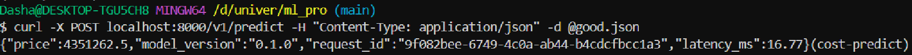
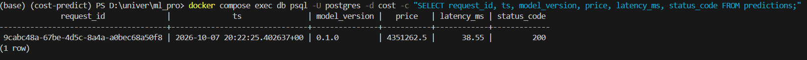
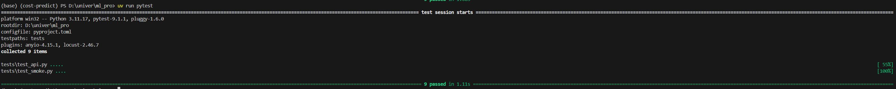
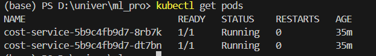

## Подготовка

Модель artifact/cost_model.joblib хранится с Git LFS.
Перед клонированием нужно установить Git LFS:
git lfs install

Если модель не скачалась автоматически:
git lfs pull

## Тесты:
uv run pytest

## Сборка docker
docker compose up -d --build

## Запуск nodes
kind create cluster --name mlpro  
kind load docker-image cost-service:1.0 --name mlpro

Сервис

Логи в Postgres

Тесты

Pods

Проблемы с которыми столкнулся:
Pods не запускался, не хватало памяти. Увеличил - заработало.
